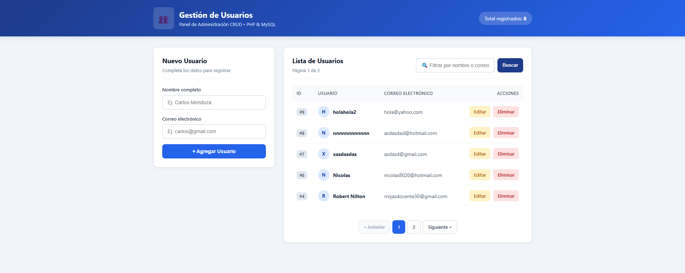

# Introduccion-a-PHP-y-BD-Proyecto-Final-Gestion de Usuarios
# 👥 Sistema de Gestión de Usuarios (CRUD en PHP y MySQL)

Proyecto Final desarrollado para el curso **Introducción a PHP y Base de Datos** (IDAT).  
Permite registrar, listar, buscar, paginar, editar y eliminar usuarios conectándose a MySQL mediante **PDO** y aplicando separación de lógica y vistas.

## Vista Previa del Sistema



## Características Principales

* **Registro de Usuarios (Create):** Formulario con validación de datos y verificación de correos duplicados.
* **Directorio con Paginación y Búsqueda (Read):** Listado dinámico paginado (5 registros por página) y filtro de búsqueda por nombre o correo electrónico.
* **Edición de Registros (Update):** Actualización de datos mediante consultas preparadas con `PDO`.
* **Eliminación Segura (Delete):** Borrado de registros con confirmación previa en JavaScript.
* **Arquitectura Limpia:** Separación entre archivos de lógica (`.php`) y plantillas de vista (`.view.php`).

## Estructura del Proyecto

```text
gestion-usuarios/
├── index.php          # Lógica principal (Crear, Listar, Buscar y Paginar)
├── index.view.php     # Vista HTML principal
├── editar.php         # Lógica para cargar y actualizar un usuario
├── editar.view.php    # Vista HTML del formulario de edición
├── eliminar.php       # Lógica para eliminar un usuario por ID
├── style.css          # Estilos del sistema
├── database.sql       # Script SQL de respaldo para crear la base de datos y tabla
├── captura.png        # Captura de pantalla del proyecto
└── README.md          # Documentación del proyecto
```

## Instalación y Uso Local (XAMPP)

1. Clonar o descargar este repositorio dentro de la carpeta `htdocs` de **XAMPP**.
2. Encender los servicios de **Apache** y **MySQL** en el panel de control de XAMPP.
3. Importar el archivo `database.sql` en **phpMyAdmin** (o conectar una base de datos existente con la tabla `usuarios`: `id`, `nombre`, `email`).
4. Abrir el proyecto en el navegador:
   * **Con configuración de puertos personalizada (Apache en puerto `8080` y SSL en `4433`):** `http://localhost:8080/gestion-usuarios/index.php`
   * **Con configuración estándar de XAMPP (puerto `80`):** `http://localhost/gestion-usuarios/index.php`

> **Nota de entorno:** En mi entorno local de XAMPP se modificaron los puertos de Apache del `80` al `8080` (HTTP) y del `443` al `4433` (HTTPS/SSL), por lo que las pruebas locales se realizaron bajo el puerto `8080`.
